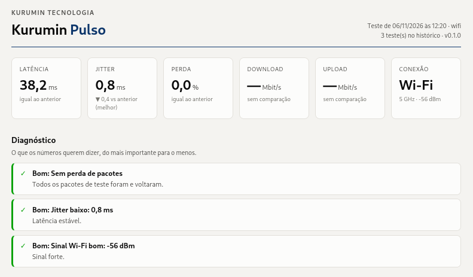
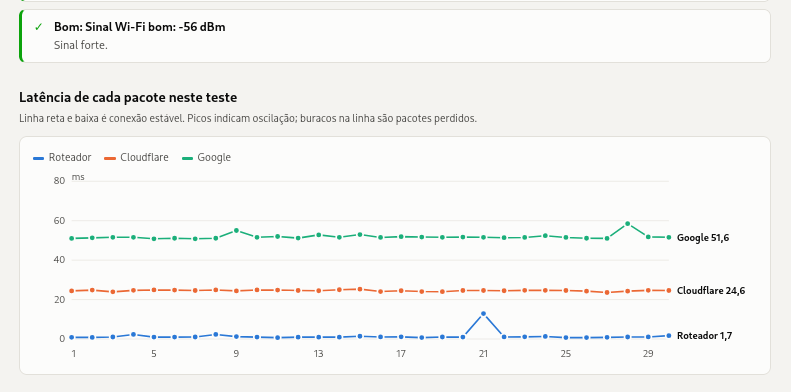
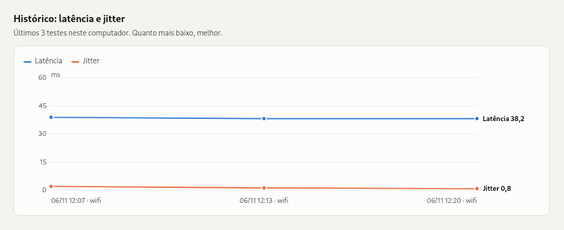

# Kurumin Pulso

**Teste de rede em um comando, com relatório em gráficos e histórico para comparar.**

O Kurumin Pulso mede a saúde da sua conexão a partir do próprio computador: latência, jitter, perda de pacotes, DNS, download e upload. Ele também diz **onde** está o problema (dentro de casa ou no provedor) e guarda cada teste para você comparar cabo × Wi-Fi, horário × horário, antes × depois de uma troca.

Feito em Python, sem dependências. Roda no **Linux** (Debian, Ubuntu, Sururu e derivados) e no **Windows 10/11**.



> Software livre, licença **GPL-3.0-or-later**. Desenvolvido pela Kurumin Tecnologia.

---

## Instalação

### Debian, Ubuntu e derivados (.deb)

Baixe o `kurumin-pulso_<versão>_all.deb` na [página de releases](https://github.com/kurumintecnologia/kurumin-pulso/releases/latest) e instale:

```bash
sudo apt install ./kurumin-pulso_*_all.deb
```

### Qualquer Linux (sem instalar pacote)

```bash
mkdir -p ~/.local/bin
curl -fsSL https://raw.githubusercontent.com/kurumintecnologia/kurumin-pulso/main/kurumin-pulso -o ~/.local/bin/kurumin-pulso
chmod +x ~/.local/bin/kurumin-pulso
```

Se `~/.local/bin` não estiver no seu `PATH`, rode com o caminho completo ou adicione a pasta ao `PATH`.

### Windows 10/11

Baixe o [`kurumin-pulso.exe`](https://github.com/kurumintecnologia/kurumin-pulso/releases/latest/download/kurumin-pulso.exe) e dê dois cliques: o teste roda e o relatório abre no navegador. Também funciona pelo terminal (`kurumin-pulso.exe --rotulo wifi`).

> O executável ainda não tem assinatura digital, então o Windows pode mostrar o aviso do SmartScreen. Clique em **Mais informações → Executar assim mesmo**. Confira a integridade do arquivo com o `SHA256SUMS` da release, se quiser.

## Uso

```bash
kurumin-pulso                         # teste completo + relatório HTML
kurumin-pulso --rotulo wifi           # dá um nome ao teste (cabo, wifi, 4g, escritorio...)
kurumin-pulso --contratado 500/250    # compara com o seu plano (Mbit/s download/upload)
kurumin-pulso --rapido                # só latência, perda e DNS (sem gastar banda)
kurumin-pulso --site https://exemplo.com.br   # mede também o tempo de resposta de um site
kurumin-pulso --json                  # saída em JSON, para scripts e painéis
```

Ao final, o terminal mostra o resumo e o caminho do relatório:

```
  KURUMIN PULSO  v0.2.0 · Kurumin Tecnologia
  ────────────────────────────────────────────────────
  Conexão   Wi-Fi (wlo1) 5 GHz, sinal -64 dBm, taxa 390 Mb/s
  Latência      27,2 ms  ▲3,4
  Perda          0,0 %
  Upload        86,9 Mbit/s
  ...
  Relatório: file:///home/voce/.local/share/kurumin-pulso/relatorios/ultimo.html
```

### Opções

| Opção | O que faz |
|---|---|
| `--rotulo NOME` | Marca o teste no histórico e nos gráficos |
| `--contratado DOWN/UP` | Compara com a velocidade do plano, em Mbit/s |
| `--rapido` | Pula o teste de velocidade |
| `--pacotes N` | Pacotes por destino (padrão: 30) |
| `--mb-down N` / `--mb-up N` | Tamanho do download e do upload em MB (padrão: 25 e 10) |
| `--site URL` | Mede o tempo de resposta de um site (pode repetir) |
| `--saida PASTA` | Onde salvar os relatórios |
| `--detalhes` | Inclui o IP do roteador no histórico e no relatório |
| `--json` | Imprime o resultado completo em JSON |
| `--abrir` | Abre o relatório no navegador ao terminar |
| `--sem-html` | Não gera o relatório |

## O que ele mede

| Medida | Como | Por que importa |
|---|---|---|
| **Latência até o roteador** | ping para o gateway | Se já tem perda aqui, o problema é **dentro de casa**: cabo, porta, Wi-Fi ou roteador |
| **Latência até a internet** | ping para 1.1.1.1 (Cloudflare) e 8.8.8.8 (Google) | Tempo de resposta real da conexão |
| **Jitter** | variação média entre pacotes seguidos | Estabilidade: chamadas de vídeo e jogos sofrem com jitter alto |
| **Perda de pacotes** | pacotes enviados × recebidos | Qualquer perda acima de 0% merece atenção |
| **DNS** | tempo para resolver domínios conhecidos | DNS lento deixa a navegação "travada" mesmo com banda sobrando |
| **Download / upload** | transferência real contra `speed.cloudflare.com` | Velocidade entregue no momento do teste |
| **Conexão** | cabo, Wi-Fi ou USB; sinal e banda do Wi-Fi; velocidade negociada do cabo | Um cabo que fecha só 100 Mb/s ou em *half-duplex* geralmente está danificado |

Sem o comando `ping` disponível, e sempre no Windows, o Pulso mede a latência pelo tempo de conexão TCP e informa isso no relatório. No Windows, o sinal do Wi-Fi vem em porcentagem e é convertido para dBm de forma aproximada.

## O relatório

Cada teste gera uma página HTML independente (abre em qualquer navegador, sem internet), com:

- cartões com os números do teste e a diferença para o teste anterior;
- **diagnóstico em linguagem simples**, do mais grave para o menos grave;
- gráfico da latência de cada pacote (roteador × internet);
- histórico de latência e jitter;
- histórico de download e upload, com a linha de 40% do contratado quando você informa o plano;
- tabela com todos os testes.

Tema claro e escuro automáticos.





## Referência de velocidade

Com `--contratado`, o Pulso compara a velocidade medida com a referência da Anatel para banda larga: **velocidade instantânea de pelo menos 40% do contratado** e **média mensal de pelo menos 80%**.

> A medição do Kurumin Pulso é **indicativa**: é feita a partir do seu computador e depende do Wi-Fi, da máquina e do horário. Ela **não substitui a medição oficial**. Use o histórico para registrar padrões (ex.: "todo dia às 20h o upload cai") antes de falar com o provedor.

## Privacidade

- Nenhum dado sai do seu computador, exceto o tráfego dos próprios testes (ping, DNS e transferência com o Cloudflare).
- O relatório e o histórico **não gravam IPs** a menos que você use `--detalhes`.
- Arquivos ficam em `~/.local/share/kurumin-pulso/` (no Windows, em `%LOCALAPPDATA%\kurumin-pulso\`):
  - `historico.jsonl`: uma linha por teste, com os números-chave;
  - `ultimo.json`: o resultado completo do último teste;
  - `relatorios/`: as páginas HTML.

## Integração com painéis

O `historico.jsonl` e a opção `--json` foram pensados para alimentar painéis de monitoramento. Para medir de hora em hora com o systemd ou o cron:

```cron
0 * * * * $HOME/.local/bin/kurumin-pulso --rapido --rotulo automatico --sem-html >/dev/null 2>&1
```

## Contribuindo

Issues e pull requests são bem-vindos. Ideias para as próximas versões:

- medição de latência sob carga (*bufferbloat*);
- testes IPv6;
- exportação em CSV;
- inclusão no repositório oficial do Debian.

Para gerar o `.deb` localmente: `bash packaging/build-deb.sh`.

## Licença

Copyright © 2026 Tácio Souza de Oliveira / Kurumin Tecnologia.

Este programa é software livre: você pode redistribuí-lo e/ou modificá-lo sob os termos da **GNU General Public License, versão 3 ou posterior**. Veja o arquivo [LICENSE](LICENSE).

---

A Kurumin Tecnologia não tem relação com o Kurumin Linux, distribuição criada por Carlos Morimoto e descontinuada em 2008.

**Kurumin Tecnologia** · contato@kurumintecnologia.com.br · [kurumintecnologia.com.br](https://kurumintecnologia.com.br)
